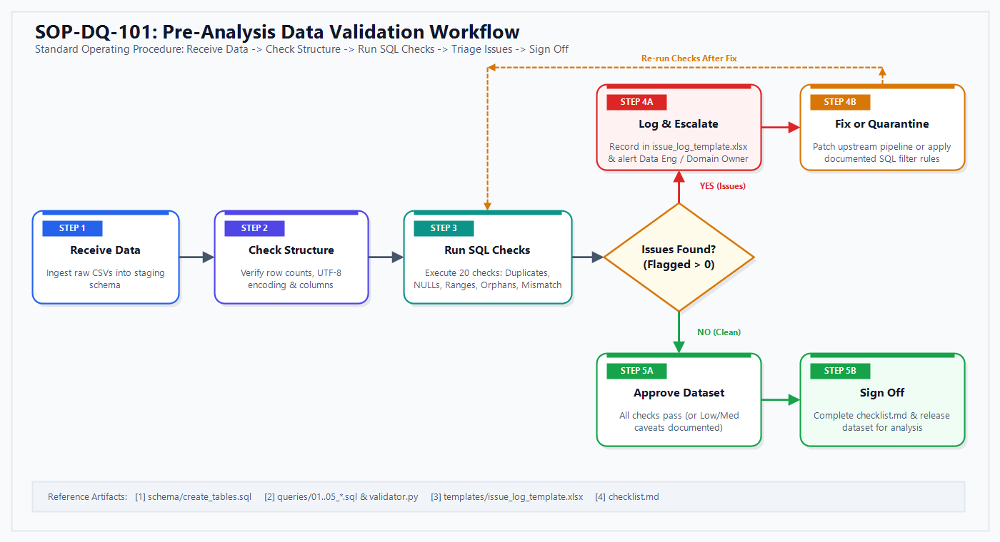

# Process Documentation Pack (SOP): Pre-Analysis Dataset Validation

This documentation pack provides a complete **Standard Operating Procedure (SOP)** for validating raw datasets before analytical consumption, BI dashboarding, or machine learning, using the **Olist Brazilian E-Commerce Dataset** as the reference case study.

Because teams need both quick-reference onboarding material and rigorous technical specifications ("simple to complex" instructions), this repository includes **two tailored versions** of the SOP alongside an interactive checklist, visual workflow diagram, and Excel issue-tracking template.

---

## 1. Repository Structure

```text
data-validation-sop/
├── SOP_simple.md                    # 1-page quick-start SOP for beginners & new analysts
├── SOP_detailed.md                  # Full technical SOP (RACI, SQL/DBeaver outputs, SLAs, remediation)
├── checklist.md                     # Tick-box validation & sign-off checklist
├── flowchart.png                    # End-to-end visual workflow diagram
├── templates/
│   └── issue_log_template.xlsx      # Excel workbook for logging & tracking data anomalies
└── README.md
```

---

## 2. What Each File Contains

| File | Target Audience | Key Contents |
| :--- | :--- | :--- |
| **[SOP_simple.md](SOP_simple.md)** | Junior Analysts, New Hires, Business Stakeholders | **1-page guide:** Purpose, the 6 core validation steps, severity quick-reference table, and who to contact (`#data-quality-help`, `#data-eng-oncall`, `#finance-ops-data`). |
| **[SOP_detailed.md](SOP_detailed.md)** | Data Analysts, BI Engineers, Analytics Leads | **Full technical specification:** Purpose, scope, RACI matrix, tools, step-by-step execution with DBeaver/SQL result snapshots from the Olist dataset, error-handling & remediation matrix, SLA escalation tiers (`SEV-1` to `SEV-4`), and version history. |
| **[checklist.md](checklist.md)** | All Validators & Reviewers | **Tick-box sign-off list:** Schema & encoding checks, primary/composite duplicate checks, status-dependent NULL checks, numeric/chronological range checks, orphan/cross-table checks, and formal sign-off block. |
| **[flowchart.png](flowchart.png)** | All Team Members | **Visual process flowchart:** `Receive Data` → `Check Structure` → `Run SQL Checks` → `Issues Found?` → (`Log & Escalate` → `Fix or Quarantine` ↺) / (`Approve Dataset` → `Sign Off`). |
| **[templates/issue_log_template.xlsx](templates/issue_log_template.xlsx)** | Data Analysts & Data Engineering | **Excel Issue Tracker:** Columns for `Date`, `Issue ID`, `Category`, `Table / Scope`, `Issue Description`, `Rows Flagged`, `Severity`, `Owner`, `Status`, and `Resolution / Notes` (pre-populated with all 16 flagged findings from the Olist audit). |

---

## 3. Process Workflow Overview



---

## 4. How to Use This SOP Pack

1. **New to the team?** Start with [SOP_simple.md](SOP_simple.md) for a 5-minute overview of the 6 validation steps and escalation contacts.
2. **Validating a new dataset release?** Open [checklist.md](checklist.md) side-by-side with [SOP_detailed.md](SOP_detailed.md) and run the SQL checks (`queries/01_duplicates.sql` through `05_cross_table_mismatch.sql`) or the Python validator (`python validator.py data.csv rules.yaml`).
3. **Found anomalies?** Log every non-zero check in [templates/issue_log_template.xlsx](templates/issue_log_template.xlsx), apply the standard remediation rule in Section 7 of `SOP_detailed.md`, or escalate `High` severity blockers before signing off.
