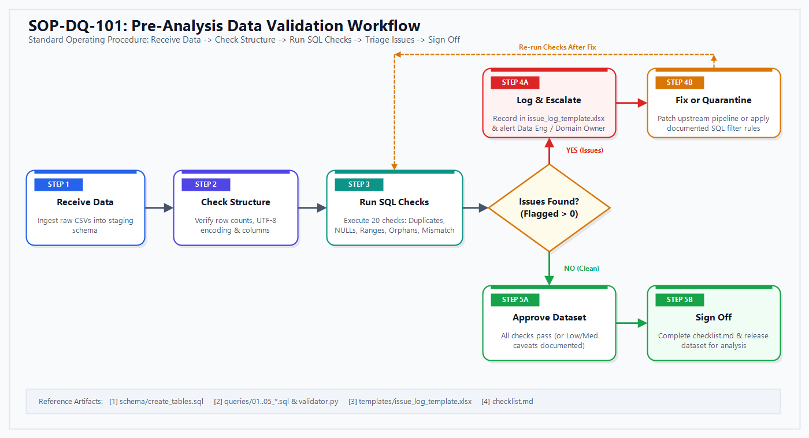

# Standard Operating Procedure (Full Technical Specification)
## How to Validate a Dataset Before Analysis

| Metadata | Details |
| :--- | :--- |
| **Document ID** | `SOP-DQ-101-DETAILED` |
| **Version** | `2.1.0` |
| **Effective Date** | `2026-11-17` |
| **Owner** | Data Analytics & Governance Team |
| **Applies To** | All relational CSV/warehouse datasets prior to BI reporting, ad-hoc analysis, or ML modeling |
| **Related Artifacts** | [SOP_simple.md](SOP_simple.md), [checklist.md](checklist.md), [flowchart.png](flowchart.png), [templates/issue_log_template.xlsx](templates/issue_log_template.xlsx) |

---

## 1. Purpose
This Standard Operating Procedure (SOP) establishes a mandatory, repeatable quality gate for validating datasets before analytical consumption. Using the **Olist Brazilian E-Commerce Dataset** (`Project 1: SQL Data Quality Audit`) as our reference implementation, this guide walks analysts from initial schema inspection through automated SQL/Python rule execution, anomaly triage, escalation, and final sign-off.

---

## 2. Scope
- **In Scope:**
  - External CSV/Parquet data deliveries (e.g., marketplace exports, partner feeds).
  - Newly ingested staging tables in PostgreSQL / MySQL prior to dimensional modeling (`dbt` / Dataform).
  - Pre-analysis sanity checks across five core dimensions: **Duplicates**, **NULLs**, **Invalid Domain/Chronological Values**, **Orphan Records**, and **Cross-Table Reconciliation Mismatches**.
- **Out of Scope:**
  - Real-time streaming event validation at the application API gateway.
  - Infrastructure uptime monitoring of production OLTP databases.

---

## 3. Roles & Responsibilities (RACI)

| Activity | Data Analyst (Validator) | Senior Analytics Lead | Data Engineering | Domain / Finance Stakeholder |
| :--- | :---: | :---: | :---: | :---: |
| Ingest staging tables & verify structure | **R** | **A** | **C** | **I** |
| Execute SQL / Python validation suite | **R** | **A** | **I** | **I** |
| Log anomalies in `issue_log_template.xlsx` | **R** | **I** | **C** | **I** |
| Triage Medium/High severity discrepancies | **C** | **R / A** | **C** | **C** |
| Fix upstream pipeline or source defects | **I** | **C** | **R / A** | **I** |
| Approve dataset sign-off (`checklist.md`) | **R** | **A** | **I** | **I** |

*(R = Responsible, A = Accountable, C = Consulted, I = Informed)*

---

## 4. Tools & Prerequisites

1. **Relational Database:** PostgreSQL 14+ (or MySQL 8.0+) with a dedicated `olist_audit` or staging schema.
2. **SQL Client:** DBeaver (v23+) or `psql` CLI.
3. **Automated Python Validator (Optional / CI):** `python validator.py <data.csv> rules.yaml` (`Project 3`).
4. **Templates:**
   - Validation Checklist: [checklist.md](checklist.md)
   - Issue Log Workbook: [templates/issue_log_template.xlsx](templates/issue_log_template.xlsx)

---

## 5. End-to-End Process Workflow



---

## 6. Step-by-Step Validation Procedure

### Step 6.1: Receive Data & Verify Structural Integrity
Before running data-level rules, confirm that the physical delivery matches the expected schema specification.

1. **Verify File Inventory & Encoding:**
   - Ensure all expected files are present and UTF-8 encoded without BOM corruption.
   - Compare row counts against the manifest.

2. **Load into Permissive Staging Tables:**
   - Execute `schema/create_tables.sql` in DBeaver.
   - **Important:** Do *not* enforce strict `PRIMARY KEY` or `FOREIGN KEY` constraints on raw staging tables during initial ingestion—doing so will cause the load to abort before you can quantify duplicates or orphans.

3. **DBeaver / Terminal Verification Preview:**
   ```text
   olist=# SELECT table_name,
                  (xpath('/row/cnt/text()', xml_count))[1]::text::int AS row_count
           FROM (
             SELECT table_name,
                    query_to_xml(format('SELECT COUNT(*) AS cnt FROM olist_audit.%I', table_name), false, true, '') AS xml_count
             FROM information_schema.tables
             WHERE table_schema = 'olist_audit' AND table_type = 'BASE TABLE'
           ) t
           ORDER BY row_count DESC;

   +----------------------+-----------+
   | table_name           | row_count |
   +----------------------+-----------+
   | geolocation          |   1000163 |
   | order_items          |    112650 |
   | order_payments       |    103886 |
   | orders               |     99441 |
   | customers            |     99441 |
   | order_reviews        |     99224 |
   | products             |     32951 |
   | sellers              |      3095 |
   | category_translation |        71 |
   +----------------------+-----------+
   (9 rows)
   ```

---

### Step 6.2: Run Category 1 — Duplicate Checks (`01_duplicates.sql`)
Identify primary key violations, composite key collisions, and exact row duplicates.

1. **Execute `queries/01_duplicates.sql` in DBeaver.**
2. **Inspect Primary & Composite Keys:**
   - `orders.order_id` (`DQ-01`) and `order_payments.(order_id, payment_sequential)` (`DQ-04`) must return `0` rows.
   - Check `order_reviews.review_id` (`DQ-02`) and `geolocation` (`DQ-03`).
3. **Expected Output Snapshot (DBeaver Result Grid):**
   ```text
   -- Query DQ-02: Duplicate review_id in order_reviews
   +----------------------------------+------------------+------------------------+
   | review_id                        | review_row_count | distinct_orders_linked |
   +----------------------------------+------------------+------------------------+
   | dbdf1ea31790c8ecfcc6750525661a9b |                3 |                      3 |
   | 4548534449b1f572e357211b90724f1b |                3 |                      3 |
   | 3242cc306a9218d0377831e175d62fbf |                3 |                      3 |
   +----------------------------------+------------------+------------------------+
   -- Summary: 789 distinct review_ids duplicated (814 excess rows)
   -- Query DQ-03: 261,831 exact duplicate coordinate rows in geolocation
   ```
4. **Action:** If a table intended as a 1:1 lookup (`geolocation` or `order_reviews`) contains duplicates, document the composite grain or create a deduplicated view before joining.

---

### Step 6.3: Run Category 2 — NULL & Conditional Completeness Checks (`02_nulls.sql`)
Standard `IS NULL` counts are not enough; you must validate **conditional completeness** based on lifecycle status (`order_status`).

1. **Execute `queries/02_nulls.sql` in DBeaver.**
2. **Verify Lifecycle Timestamps & Catalog Attributes:**
   - `DQ-05`: `order_status = 'delivered' AND order_delivered_customer_date IS NULL`
   - `DQ-06`: `order_status = 'delivered' AND order_approved_at IS NULL`
   - `DQ-07`: `order_status IN ('delivered', 'shipped') AND order_delivered_carrier_date IS NULL`
   - `DQ-08`: `products.product_category_name IS NULL`
3. **Expected Output Snapshot:**
   ```text
   -- Query DQ-05: Delivered orders missing customer delivery timestamp (8 rows)
   +----------------------------------+-----------+--------------------------+-------------------------------+
   | order_id                         | status    | order_purchase_timestamp | order_delivered_customer_date |
   +----------------------------------+-----------+--------------------------+-------------------------------+
   | 2d1e2d5bf4dc7227b3bfebb81328c15f | delivered | 2017-11-28 17:44:07      | [NULL]                        |
   | f5dd62b788049ad9fc0526e3ad16bc01 | delivered | 2018-06-20 06:58:43      | [NULL]                        |
   | 2ebdfc4f15f23b91474b67b1c73c1b76 | delivered | 2018-07-01 17:05:11      | [NULL]                        |
   +----------------------------------+-----------+--------------------------+-------------------------------+
   ```

---

### Step 6.4: Run Category 3 — Invalid Domain & Chronological Checks (`03_invalid_values.sql`)
Validate numeric boundaries (`price > 0`, `payment_value > 0`, `product_weight_g > 0`) and temporal state transitions.

1. **Execute `queries/03_invalid_values.sql` in DBeaver.**
2. **Verify Chronological Order of Operations:**
   - Every order must satisfy:
     $$\text{purchase\_timestamp} \le \text{approved\_at} \le \text{delivered\_carrier\_date} \le \text{delivered\_customer\_date}$$
3. **Expected Output Snapshot:**
   ```text
   -- Query DQ-11: Customer delivery before carrier handoff (23 rows flagged)
   +----------------------------------+------------------------------+-------------------------------+------------+
   | order_id                         | order_delivered_carrier_date | order_delivered_customer_date | hours_diff |
   +----------------------------------+------------------------------+-------------------------------+------------+
   | 2fb597c2f7720ab52ef16ca73d38c890 | 2017-07-10 19:50:48          | 2017-07-05 15:43:29           |    -124.12 |
   | 7645888999246f86b249a2c44abbc715 | 2017-07-26 19:22:05          | 2017-07-20 19:22:00           |    -144.00 |
   +----------------------------------+------------------------------+-------------------------------+------------+
   ```

---

### Step 6.5: Run Category 4 — Orphan & Referential Integrity Checks (`04_orphan_records.sql`)
Use `LEFT JOIN ... WHERE child.id IS NULL` across all parent-child relationships.

1. **Execute `queries/04_orphan_records.sql` in DBeaver.**
2. **Verify Key Relationships:**
   - `orders -> customers` (`DQ-14`: `0` orphans)
   - `orders -> order_payments` (`DQ-15`: `1` delivered order `bfbd0f9bdef84302105ad712db648a6c` missing payment)
   - `orders -> order_items` (`DQ-16`: `775` orders without line items)
   - `products -> category_translation` (`DQ-17`: `13` products across `pc_gamer` and `portateis_cozinha_e_preparadores_de_alimentos` missing English translation)

---

### Step 6.6: Run Category 5 — Cross-Table & Lifecycle Mismatches (`05_cross_table_mismatch.sql`)
Reconcile aggregated financial totals across tables and check for conflicting status-timestamp combinations.

1. **Execute `queries/05_cross_table_mismatch.sql` in DBeaver.**
2. **Reconcile Order Totals vs. Payment Totals (`DQ-18`):**
   - Compare `SUM(price + freight_value)` in `order_items` against `SUM(payment_value)` in `order_payments`.
   - Use a `R$ 0.05` tolerance threshold to separate minor installment division rounding (`269` orders) from real financial discrepancies (`310` orders).
3. **Expected Output Snapshot:**
   ```text
   -- Query DQ-18: Payment total != Order items total (diff > R$ 0.05 -> 310 rows)
   +----------------------------------+------------+--------------+----------------------+----------------------+--------------+
   | order_id                         | item_count | payment_rows | expected_order_total | actual_payment_total | payment_diff |
   +----------------------------------+------------+--------------+----------------------+----------------------+--------------+
   | ce6d150fb29ada17d2f83422e0014370 |          1 |            1 |              1399.03 |              1581.84 |      +182.81 |
   | 6e5fe7366a2e1bfbf3257dba0af1267f |          1 |            1 |               295.07 |               407.99 |      +112.92 |
   | 70b742795bc441e94a44a084b6d9ce7a |          2 |            1 |               151.62 |               100.00 |       -51.62 |
   +----------------------------------+------------+--------------+----------------------+----------------------+--------------+
   ```

---

### Step 6.7: Export Discrepancies, Log Issues & Complete Sign-Off
1. **Export Flagged Rows:**
   - Run the `\copy` export in `05_cross_table_mismatch.sql` (or DBeaver **Export Resultset -> CSV**) to generate `output/discrepancy_report.csv`.
2. **Update Issue Log:**
   - Open [templates/issue_log_template.xlsx](templates/issue_log_template.xlsx) and log each check where `rows_flagged > 0`, assigning a Severity (`High`, `Medium`, `Low`), Owner, and Status.
3. **Complete Checklist:**
   - Tick all verified boxes in [checklist.md](checklist.md) and attach the sign-off block to your analysis PR or ticket.

---

## 7. Error Handling & Remediation Matrix

| Error / Anomaly Type | Example Check | Standard Analytical Remediation |
| :--- | :--- | :--- |
| **Duplicate Lookup Keys** | `DQ-02` (`order_reviews`), `DQ-03` (`geolocation`) | Deduplicate into a CTE/view (`GROUP BY zip_code_prefix` or `DISTINCT ON (review_id)`) before joining to fact tables. |
| **Missing Status Timestamp** | `DQ-05` (`8` delivered orders missing delivery date) | Exclude from transit-duration SLA metrics (`WHERE order_delivered_customer_date IS NOT NULL`), but retain in GMV/order-count totals. |
| **Missing Dimension Attribute** | `DQ-08` (`610` products missing category), `DQ-17` (`13` untranslated) | Use `LEFT JOIN` (never `INNER JOIN`) to `products`/`category_translation` and wrap categories in `COALESCE(category, 'unclassified')`. |
| **Chronological Inversion** | `DQ-11` (`23` orders delivered < carrier), `DQ-12` (`166` carrier < purchase) | Quarantine inverted rows from lead-time distribution models (`lead_time_days >= 0`); escalate webhook timezone bug to Data Engineering. |
| **Orphan Parent / Child** | `DQ-15` (`1` order without payment), `DQ-16` (`775` orders without items) | Document whether analysis uses `orders` grain (`99,441`), `order_items` fulfilled grain (`98,666`), or settled `order_payments` grain (`99,440`). |
| **Cross-Table Total Mismatch** | `DQ-18` (`310` orders where payment ≠ item total) | Use `SUM(price + freight_value)` for Merchandise GMV and `SUM(payment_value)` for Cash Collected (which includes installment interest). |

---

## 8. Escalation Matrix & SLAs

| Severity Level | Trigger Criteria | Escalation Target | Response SLA | Resolution Action |
| :--- | :--- | :--- | :--- | :--- |
| **SEV-1 (Critical / Blocker)** | Primary key duplicates in core fact table (`orders`), >1% orphan records on required FKs, or missing table delivery. | Data Engineering On-Call (`#data-eng-oncall`) + Analytics Lead | **< 2 hours** | Halt downstream reporting; hotfix ingestion pipeline and reload staging schema. |
| **SEV-2 (High)** | Status-timestamp contradictions (`DQ-05`, `DQ-11`, `DQ-12`, `DQ-20`) or missing payments on delivered orders (`DQ-15`). | Data Quality Lead (`#data-quality-help`) + Source System Owner | **< 1 business day** | Quarantine flagged rows in analytical views; open engineering bug ticket with `discrepancy_report.csv`. |
| **SEV-3 (Medium)** | Catalog metadata NULLs (`DQ-08`), zero-value vouchers (`DQ-10`), or payment vs. item total differences (`DQ-18`). | Domain / BI Lead (`#finance-ops-data`) | **< 3 business days** | Apply documented `COALESCE` / filtering rules in `SOP_detailed.md` Section 7 and note caveats in report footer. |
| **SEV-4 (Low)** | Minor missing translation rows (`DQ-17`, <0.05% impact). | Analytics Backlog | **Next Sprint** | Patch reference lookup seed file (`category_translation.csv`). |

---

## 9. Version History

| Version | Date | Author | Summary of Changes |
| :--- | :--- | :--- | :--- |
| `1.0.0` | `2026-09-01` | Data Governance Team | Initial SOP draft for relational CSV pre-analysis validation. |
| `2.0.0` | `2026-10-15` | Senior BI Engineer | Added 20-check SQL audit taxonomy across 5 categories based on Olist e-commerce audit. |
| `2.1.0` | `2026-11-17` | Data Analytics Team | Integrated automated Python validator (`Project 3`), remediation matrix, and SLA escalation rules. |
