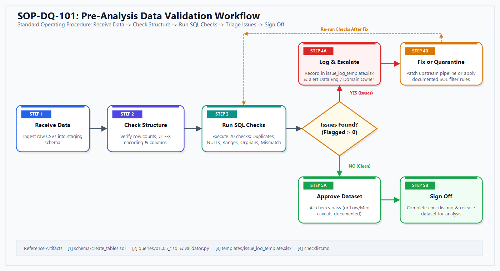

# Standard Operating Procedure (Quick-Start Guide)
## How to Validate a Dataset Before Analysis

**Document ID:** SOP-DQ-101-SIMPLE  
**Version:** 1.0  
**Audience:** Junior Data Analysts, BI Analysts, New Team Members  
**Estimated Time:** 15–20 minutes per dataset  

---

## 1. Purpose
Before building any dashboard, report, or machine learning model, you must verify that the raw dataset is complete, accurate, and consistent. Skipping validation can lead to wrong revenue numbers, broken charts, or misleading business insights (for example, counting duplicate rows or missing canceled orders).

---

## 2. The 6-Step Validation Process

### Step 1: Receive Data & Check Structure
Confirm that all expected files/tables arrived and match the schema documentation.
- Check row counts, column names, and data types (`VARCHAR`, `TIMESTAMP`, `NUMERIC`).
- **Stop immediately** if a required file or column is missing.

### Step 2: Check for Duplicates
Verify that primary keys (such as `order_id` or `product_id`) appear only once, and check reference tables (like `geolocation`) for exact duplicate rows that could multiply your numbers during a `JOIN`.

### Step 3: Check for Missing Values (NULLs)
Look for missing values in mandatory columns—especially status-dependent fields.
- *Example:* If `order_status = 'delivered'`, the delivery date (`order_delivered_customer_date`) must not be `NULL`.

### Step 4: Check for Invalid Values & Bad Dates
Verify that numbers and dates make logical sense in the real world:
- Prices and weights must be greater than `0` (`price > 0`, `product_weight_g > 0`).
- Dates must follow chronological order (`order_delivered_customer_date >= order_delivered_carrier_date >= order_purchase_timestamp`).

### Step 5: Check Cross-Table Links (Orphans & Mismatches)
Ensure linked tables agree with each other:
- **Orphans:** Every order has a customer and payment record; every product category exists in the translation table.
- **Mismatches:** The sum of item prices + shipping (`order_items`) matches the total amount paid (`order_payments`).

### Step 6: Log Issues or Sign Off
- **If High-Severity issues are found:** Record them in `templates/issue_log_template.xlsx` and escalate before using the data.
- **If no blocking issues are found (or Low/Medium issues are documented):** Complete `checklist.md` and sign off to begin analysis.

---

## 3. Severity Quick Reference

| Severity | Meaning | What You Should Do |
| :--- | :--- | :--- |
| **High (Blocker)** | Corrupts core KPIs (e.g., duplicate primary keys, missing payments on delivered orders, inverted delivery dates). | **STOP.** Log in Issue Log and escalate to Data Engineering. Do not publish analysis. |
| **Medium (Warning)** | Affects specific slices/columns (e.g., missing product category on <2% of rows, minor rounding differences). | **DOCUMENT.** Log the issue, apply the standard filter/imputation rule in `SOP_detailed.md`, and note the caveat in your report. |
| **Low (Info)** | Cosmetic or non-blocking (e.g., untranslated category label for 13 rows). | **LOG & PROCEED.** Record in Issue Log for future cleanup and continue analysis. |

---

## 4. Who to Contact

| Role | Contact / Channel | When to Reach Out |
| :--- | :--- | :--- |
| **Data Quality Lead / Senior Analyst** | `#data-quality-help` / `dq-lead@company.local` | Unsure whether an anomaly is a High or Medium issue, or how to filter dirty rows. |
| **Data Engineering On-Call** | `#data-eng-oncall` / `data-pipeline-support@company.local` | Missing tables, broken CSV loads, primary key duplicates, or High-severity pipeline bugs. |
| **Domain / Finance Owner** | `#finance-ops-data` / `finance-analytics@company.local` | Payment vs. order total mismatches (`order_items` ≠ `order_payments`) or refund questions. |
